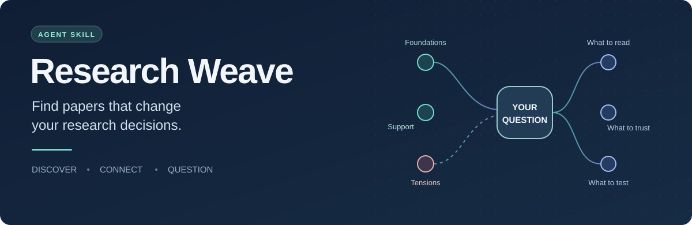

<p align="center">
  
</p>

<p align="center">
  <strong>An agent skill for discovering valuable papers, mapping evidence, and positioning your research.</strong><br>
  <a href="README.zh-CN.md">简体中文</a> ·
  <a href="#quick-start">Quick start</a> ·
  <a href="examples/self-correction/report.md">Worked example 中文</a> ·
  <a href="skills/research-weave/SKILL.md">Read the skill</a>
</p>

**Turn a pile of papers into a reading plan, an evidence map, and a sharper research question.**

**Validation boundary:** Online search recall and comparative quality/cost have not been benchmarked. Behavioral evidence comes from small supplied corpora and a bounded historical walkthrough.

## Why Research Weave?

Research attention is scarce. As paper production accelerates, polished abstracts and fluent AI summaries can make very different bodies of evidence look equally convincing. The hard questions remain:

*Which papers deserve a close read? What is actually established? Do these findings agree? And what would they change about my research?*

Research Weave gives your agent a repeatable way to investigate those questions. It traces how a field developed, connects scoped claims across papers, weighs converging and conflicting evidence, and returns a reading queue with reasons to prioritize, defer, or exclude each work.

The goal is to help you spend your attention where it can change a research decision.

## Five lenses for finding papers that matter

| Lens | What the agent investigates | What you gain |
|---|---|---|
| **Intellectual history** | Which works changed the problem, method, or evaluation? What did later work adopt or challenge? | An explanation of the field's branches and turning points |
| **Evidence networks** | Which claims support, bound, depend on, or challenge one another? | Connections across papers and neighboring fields, with provenance |
| **Research relevance** | Does this provide a fact, mechanism, method, evaluation tool, boundary, counterexample, or analogy? | A concrete link to your next research decision |
| **Converging support** | How many papers and independent evidence contributions support this proposition, under which conditions? | A reasoned assessment of support breadth, quality, and transfer limits |
| **Contradictions** | Are opposing results genuinely comparable? What test could separate the explanations? | Candidate research questions and falsifiable diagnostic experiments |

**More credible, independent, applicable evidence can strengthen a claim.** The skill tracks supporting papers, shared result families, and confirmed independent contributions separately. Repeated reports of one experiment remain one underlying result. Local findings keep their scope when mapped to broader propositions.

## What you get

- **An ordered reading queue:** what to read, the exact section to inspect, and the decision it could change.
- **A research map:** historical branches and claim relationships, separating source-supported links from analytical hypotheses.
- **An evidence synthesis:** converging support, the strongest counterevidence, shared dependencies, and unknowns.
- **A tension analysis:** comparable conflicts, scope mismatches, inconclusive comparisons, and tests that could resolve them.
- **A project position:** inherited assumptions, established evidence, the unsupported step, and the next useful observation—including what would make the proposed gap disappear.

Saved runs usually contain:

```text
report.md       Reading decisions, evidence map, tensions, and research position
evidence.json   Reusable claims, provenance, support synthesis, and relationships
search-log.md   Searches, screening decisions, access limits, and stopping reason
```

Scout starts with a short decision report and an [optional compact ledger](examples/scout/evidence.json); a full network is reserved for Map/Update or when it changes the decision. Existing maps can be updated as papers or corrections arrive.

## A worked example: can LLMs self-correct?

Self-Refine, *Large Language Models Cannot Self-Correct Reasoning Yet*, and CRITIC make a useful historical test case. Their titles alone cannot establish a like-for-like disagreement.

The [corrected three-paper walkthrough 中文](examples/self-correction/report.md) records each paper’s main conclusion, including intrinsic correction failures, oracle stopping, response-matched baselines, and both positive and negative no-tool rows. The first version omitted decisive negative evidence; its [snapshot](evals/runs/example-v1/report.md) and [revision notes](evals/revision-2026-10-31.md) remain available. It produces a focused reading queue, conditional support synthesis, and a diagnostic experiment with an outcome that would weaken the motivation. The example is bounded to selected historical evidence; it does not claim to survey the current field.

For an additional test, an [explicitly fictional source packet](evals/fixtures/agent-feedback.md) includes repeated evidence, an abstract-only headline, a cross-field analogy, and conflicting results. You can inspect the [independent trial and corrections 中文](evals/runs/offline-network/report.md).

## Quick start

### Install for Codex

Clone this repository, then copy the skill folder into your user skills directory:

```bash
git clone https://github.com/NeuraLiying/research-weave-skill.git
cd research-weave-skill
mkdir -p ~/.agents/skills
cp -R skills/research-weave ~/.agents/skills/
```

This uses the user directory documented in [official Codex skill guidance](https://learn.chatgpt.com/docs/build-skills#where-codex-loads-local-skills). For a project-only installation, place the folder at `.agents/skills/research-weave/` in that project. This location was rechecked against official guidance on 2026-10-31. An existing host configured to discover `~/.codex/skills` can retain that location; use the directory your host actually loads and avoid duplicate installations. When updating, replace the skill folder rather than creating a nested duplicate.

The core is plain `SKILL.md` instructions plus references and a Python helper. In another agent environment that supports this format, use its documented skill directory and invocation method. The documented trial here used Codex; other runtimes have not been independently tested.

### Give it a research decision

```text
Use $research-weave.

I'm studying tool-free self-correction for exact-answer reasoning
with a frozen LLM. I need to decide whether to build a revision loop
or spend the same inference budget on resampling.

Trace the important historical branches and current work. Compare
supporting and conflicting evidence, keeping feedback access and
compute budgets explicit. Choose the three papers most worth a close
read, explain how each could change my decision, and propose one
diagnostic experiment that could overturn the motivation.
```

Start with a direction if your question is still broad. Add tasks, models, feedback access, budgets, known papers, and the decision you face when available. Output follows your language; you can ask in English or Chinese.

| Mode | When to use it |
|---|---|
| **Scout** | Get oriented and decide what deserves deeper investigation |
| **Map** | Investigate a concrete question across lineages and evidence |
| **Update** | Integrate new papers or corrected results into an existing map |

Live discovery needs search and source access from the host agent. With only local papers or excerpts, the skill can produce a corpus-bounded analysis and retain access-related uncertainty. The workflow requires no specific model, paid API, or other skill. The evidence checker uses Python 3.9+ and the standard library.

## Trust and validation

Every decision-bearing claim should point to an inspected source location. Abstract-only leads remain provisional. Observations, author interpretations, and agent inferences are recorded separately. A quiet literature search does not establish that a result or a resolution does not exist.

The repository includes **37 checker tests**, a corrected real-paper walkthrough, and independent trials on fictional corpora. Independent review also reproduced missing main-result coverage, relabeled duplicate sources, and a malformed-input crash. The checker and example were revised. The initial trial exposed a scope-transfer error: a local negative finding had been counted as direct support for a universal failure claim. The rule and output were corrected; the initial artifact is retained. This is an early version with inspectable validation, without a comparative performance claim.

```bash
python3 -m unittest discover -s tests -v
python3 skills/research-weave/scripts/check_evidence.py examples/self-correction/evidence.json
```

The checker rejects duplicate declared source identities, inconsistent evidence statuses/counts and unsupported relationship endpoints; it cautions on undeclared relationship provenance, shared source metadata and unknown fields. Different labels can still hide an undisclosed shared origin: the checker does not establish actual independence, logical entailment, main-result completeness or search recall. Source review remains necessary. Full details: [current revision validation 中文](evals/revision-2026-10-31.md), [historical validation 中文](evals/validation.md).

## Explore and improve

- [Skill instructions](skills/research-weave/SKILL.md) — the workflow your agent loads.
- [Evidence method](skills/research-weave/references/evidence-method.md) — discovery, quality, relevance, and convergence.
- [Contradiction analysis](skills/research-weave/references/contradictions.md) — alignment and separating tests.
- [Output contract](skills/research-weave/references/output-contract.md) — reusable evidence records.
- [Design research 中文](docs/design-and-research.zh.md) — related skills, inspirations, and positioning.

Have a case where the agent missed an important paper, overcounted support, or invented a conflict? [Open an issue](https://github.com/NeuraLiying/research-weave-skill/issues) with the research question, accessible sources, observed output, and the judgment that needs correction. Please use public or shareable material. Concrete failures help improve the skill.
