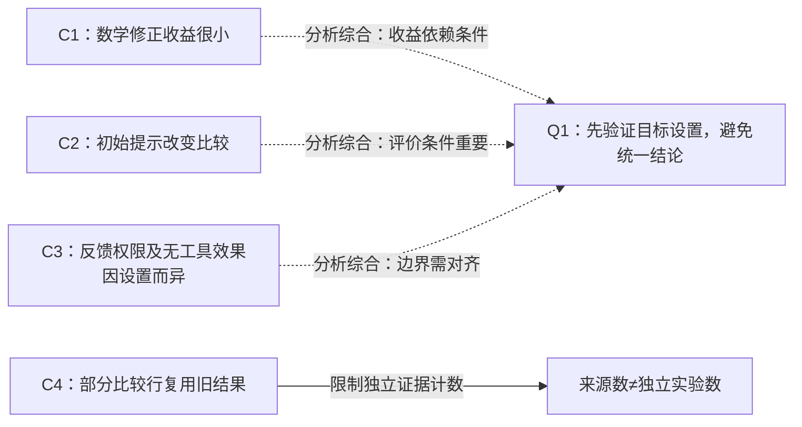

# 示例：自我修正文献如何改变研究判断

日期：2026-10-31。问题：是否以“无外部反馈的冻结模型修正能提高精确推理”为研究出发点？这是固定三篇 2023–2024 历史论文的 bounded scout，只检查相关章节，不代表 2026 年领域现状。目标模型、任务与预算尚未指定。

## 阅读队列

| 顺序 | 论文与动作 | 阅读位置 | 对决策的用途 |
|---|---|---|---|
| 1 | [Cannot Self-Correct Reasoning Yet](https://proceedings.iclr.cc/paper_files/paper/2024/file/8b4add8b0aa8749d80a34ca5d941c355-Paper-Conference.pdf)，精读相关实验 | §3–5，尤其 Table 8 | 决定初始提示、反馈权限及预算控制是否充分 |
| 2 | [Self-Refine](https://proceedings.neurips.cc/paper_files/paper/2023/file/91edff07232fb1b55a505a9e9f6c0ff3-Paper-Conference.pdf)，局部读 | §2、Table 1、Appendix K.1 | 复原循环；确认目标任务的证据是否支持总体印象 |
| 3 | [CRITIC](https://proceedings.iclr.cc/paper_files/paper/2024/file/fef126561bbf9d4467dbb8d27334b8fe-Paper-Conference.pdf)，局部读 | §4.2、Table 2、Appendix D.6 | 区分工具反馈、无工具消融及复用的旧结果 |

暂缓三篇中与当前精确推理决策无关的偏好评测细节和毒性实验；不因为论文重要就要求通读全部附录。

## 证据如何连接

Self-Refine Table 1 的数学行变化为 0、+0.2、+0.2 个百分点，不能把其他任务的大幅收益直接转成数学推理收益。Huang 等在 §5/Table 8 检查初始提示这一混杂因素。CRITIC Table 2 的无工具行在部分设置仍有提升，因此也不能推导“无工具一定无效”。原文位置及各自条件见上述主来源和 `evidence.json` 的 C1–C3。

这里可追溯的历史联系是：Huang 等实际重查 Self-Refine 的一个评价设置；CRITIC 沿工具反馈分支展开，并在 Appendix D.6 明确复用部分 Self-Refine 比较结果。三篇的关系涉及方法、评价和信息权限，不能只按发表年份串成一条进步线。[Huang 等 §5](https://proceedings.iclr.cc/paper_files/paper/2024/file/8b4add8b0aa8749d80a34ca5d941c355-Paper-Conference.pdf)、[CRITIC Appendix D.6](https://proceedings.iclr.cc/paper_files/paper/2024/file/fef126561bbf9d4467dbb8d27334b8fe-Paper-Conference.pdf)。

虚线为本示例的分析综合，并非论文之间已经建立的独立复制关系。

## 支持汇聚与矛盾

对 Q1“收益具有条件性，应先验证目标设置”，本包有 3 篇论文、3 个保守划分的来源家族提供相关结果；**已确认的独立重复检验数未知**。模型与基准有重叠，三者并非同一估计目标的匹配复制。CRITIC 引用的旧表也不能再算一轮独立确认。因此判断为 `conditional`，不估计“几成可信”，也不合并效果量。

标题之间的表面冲突不足以形成可比冲突。Self-Refine 与 CRITIC 的设置、初始输出、反馈和停止规则没有对齐，归类为 `scope_mismatch`。本包没有建立一个尚未解决的同条件矛盾，也没有完成后来文献的解决情况检索。

## 可以做的下一步诊断

以下为本示例提出的分析实验，不是上述论文已经证实的结论，也不是经过新颖性核查的方法。

在用户目标模型与任务上固定初始答案、提示、评测器和总预算，比较：充分初始提示后的直接回答、等预算重采样、无工具修正。诊断支路加入可靠反馈和打乱反馈负对照；它们用于区分解释，不能偷偷计入无工具方案。

若信息质量是关键，可靠反馈应优于打乱反馈；若额外采样足够，重采样应能匹配收益；若初始指令不足是主因，补全初始提示应明显缩小修正优势。记录最终准确率、纠错/改错、全部 token 与调用成本和不确定性。

**让 motivation 消失的结果：** 充分提示及等预算重采样消除了修正优势。此时应收窄或放弃“特定修正机制带来额外价值”的动机。

## 覆盖边界

检查了三篇主来源的相关定义、方法、结果和部分附录；没有逐页通读，没有进行完整前向引文、跨领域桥接、版本/撤稿状态及 2025–2026 新研究检索。检索与停止原因见 [search-log.md](search-log.md)。这个例子验证可追溯的分析形状，不建立当前研究建议或 skill 的比较优势。
