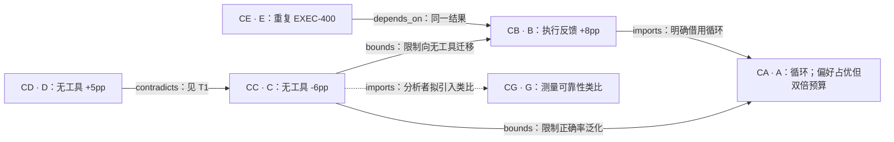

# 无工具 frozen-model 自我修正：先做诊断，再决定是否建设循环

**阅读顺序：C → D → B。当前建议是先做一个受控诊断实验，不承诺无工具循环能在目标条件下稳定提升正确率。** C 给出负效应，D 在名义相同条件下给出正效应；两者都应保留。B 的正效应发生在外部执行反馈条件，不能直接支持无工具路线。

工作解释：冻结 M-1，精确答案推理，每题 **2,000 个全成本 tokens**，无工具、无外部正确性反馈、无真值停止，比较等预算重采样。R、E、具体模型快照和选择器只知道标识或未报告。以下仅使用附件 A–H 的**虚构材料**，截至 2026-10-31；没有联网，也不是现实文献结论、新方法或新颖性判定。

## 阅读队列与取舍

“精读”仅指认真重建附件中可见的相关方法/结果，**没有取得全文**。三篇额度用于 C、D、B；其余为定点核查或待访问，不能冒称又精读了三篇。

| 顺序 | 文章与行动 | 精确阅读位置 | 会改变什么判断、为何优先 |
|---|---|---|---|
| 1 | C — *Revision Without External Feedback*，`deep_read` | §2；§3；Table 2；§6 | 与目标最直接，负向结果检验立项的核心假设；公平预算和适用边界比热门口号更重要。 |
| 2 | D — *Intrinsic Revision Revisited*，`deep_read` | §2；Methods；Table 1；§5 | 显式尝试 C 的设置却结果相反；决定不能凭 C 宣判普遍失败。重点找缺失工件和隐藏实现差异。 |
| 3 | B — *Execution-Assisted Revision*，`deep_read` | §3；§5 | 识别工具反馈分支的最强条件证据及信息访问边界；优于再读一篇不可评估的泛化摘要。 |
| 4 | A — *Iterative Drafting*，`targeted_read` | §2、§4、Appendix A | 确认循环的包内历史来源，但偏好评价、双倍预算无法直接支持目标正确率。 |
| 5 | G — *Selective Measurement in Control*，`targeted_read` | §2、§4 | 为诊断变量提供“信息可靠性改变行动价值”的类比，不充当 LLM 实证。 |
| 6 | E — *Three Studies Prove Critique Works*，`exclude` 其独立效果证据资格 | §3 | 核查后保留依赖记录；B、预印本、教程仍是同一个 EXEC-400 结果，不能当三次确认。 |
| 7 | F — *Universal Self-Improvement*，`verify_access` | 需要方法、模型、任务、30%定义、预算/选择规则、结果与区间 | 是可能改变判断的线索；只有摘要且引用数未经核验，无法占据支持票或精读名额。 |
| 8 | H — *Adaptive Revision Policy*，`verify_access` | 至少摘要和方法/结果 | 只有标题与年份，暂时连结果主张也无法提取。本轮没有附件外访问权限。 |

来源：[C §2/§3/Table 2/§6](input.initial.md)、[D Methods/Table 1/§5](input.initial.md)、[B §3/§5](input.initial.md)。其他条目的原始标识与位置保存在 `evidence.json`。

## 历史与证据网络

这不是一条“越新越好”的线性进步史，而是三个需要区分的分支：

- **循环操作分支**：A（2019）定义冻结模型 draft → critique → revise。B（2021）§3 明确借用它，将内在批评替换为执行反馈；这一借用关系有来源支持，但正效应属于带工具条件。
- **评价与反证分支**：C（2023）§2 引 A，明确把创作偏好与精确正确率分开，并采用匹配预算；D（2024）§2 明确尝试 C 的设置，构成其结果的挑战。评价构念、预算和可复核性改变了研究问题，不能把每篇正面结果叠成“自我修正有效”。
- **邻域类比分支**：G（2008）谈选择性测量及可靠性。没有材料证明 A/B/C 借用过 G；它仅由本分析引入为诊断灵感。A 的附件文字称其为包内最早工作，但 G 的标注年份更早；因此只称 A 为**包内最早明确循环操作的工作**，不作世界首创或完整年代优先权判断。

E（2024）是结果转载与依赖问题，未增加实验。F（2025）和 H（2026）访问不足，不能据年份或名气把它们写成已经改变领域的转折点。[A §2/§4/附录](input.initial.md)、[E §3](input.initial.md)、[G §2/§4](input.initial.md)。

实线表示可见来源支持的关系，虚线表示分析者假设。`X imports Y` 表示 X 借入 Y；`X bounds Y` 表示 X 限制 Y 的泛化范围，**不表示时间影响或 Y 的实验错误**。C→B 边只标反馈/任务范围边界，不是工具正效应与无工具负效应的直接矛盾。E→B 为共享证据；C/D 虽有不同结果族，仍共用 REASON-200，不标为独立。A/G 等来源独立性未知。

## 证据强度、收敛与反证

最强的三个可见观测都以最终准确率相对匹配预算重采样的**百分点差**表示，不能与 F 未定义的“30%”直接比较：

| 证据卡 | 来源观测 | 作者解释 | 本分析推论与限制 |
|---|---|---|---|
| CB / B §5 | 400 配对程序题，+8pp，配对 95% 区间 [+4,+12]；含执行失败，双方 2,000 全成本 tokens | 没有额外提供可分离的信息机制结论 | 支持该执行反馈设置的增益；未测无工具组，也未识别信息内容的因果作用。绝对准确率未报。 |
| CC / C Table 2 | 200 配对题，−6pp，区间 [−10,−2]；M-1 / R / E / REASON-200，无外部反馈与正确性停止 | §6 不推广到更新模型或外部验证修订 | 直接反对把目标循环有效当默认；不是所有模型、所有条件下失败的证明。 |
| CD / D Table 1 | 同 REASON-200、新生成输出，+5pp，区间 [+2,+8]；所列协议同 C | §5 提到随机抽样与实现差异可能相关 | 直接反对普遍失败论；缺代码和逐题预测，正向结果也不能被提升为稳健独立复现。 |

以上“supported”仅指节选支持其限定范围的观测，未表示外部真实性核验。模型快照、具体 R/E 实现、选择器、随机重复次数等缺失须保持未知。

支持广度应使判断更强，但前提是研究可信、独立、直接适用，并经得住最强反证；**论文数量不能替代这些条件**。本包的命题级情况如下：

| 命题 | 直接支持论文 / 已知支持结果族 | 反证 | 独立性与覆盖 | 综合判断 |
|---|---|---|---|---|
| P1：所列目标条件下无工具修订的平均净效果为正 | D：1 / 1 | C：1 / 1，−6pp | 支持集合D只有1项原始独立贡献；D与反证C共用题集、实施独立性未知，未形成跨任务/模型确认 | `contested`；正平均效果亦未建立可靠稳定收益 |
| P2：所有满足目标约束的运行都无益或有害 | 0 / 0；C只属局部负向候选 | D：1 / 1，+5pp | C不能支持全称命题，D提供在域正向反例 | `contested`；全称失败断言没有直接支持 |
| P3：B 的执行反馈设置有正向收益 | B：1 / EXEC-400 1族 | 包内无直接反证 | B原始实验计1项独立支持贡献；E转述不增加贡献，额外独立复核0。仅一种程序题分支 | `conditional`，不是无工具证据 |
| P4：包内已形成目标条件下的多篇独立收敛 | 0 / 0 | C 的负证据；E 的重复计数 | A/B/E/G 不满足直接目标，F/H 不可充分评估 | `insufficient`；缺收敛不等于证明无效 |
| P5：内在批评的可靠信息解释了增益或 C/D 分歧 | 0 / 0 个直接机制实验 | 尚无可检验的直接机制反证 | G 是类比；B 缺信息消融；C/D 只有净效果 | `insufficient`，保留为假说 |

`independent_evidence_count` 计互相独立的支持贡献，包含原始实验，不计“原实验之外有多少次复制”。P1支持集合仅D，计1；P3仅B，计1；P2/P4/P5无直接支持，计0。“额外独立复核为0”是另一项包内状态，不能外推为现实中不存在。C/D整体独立关系未知，不因结果族名不同而标为独立。没有强行把某个命题标为 `convergent`。若以后新增多团队、独立题集、不同测量且预算公平的正向研究，将增加支持广度；但一个可信且在域的反例仍能否定“总能改善”之类全称断言。当前不做效应平均、投票或任意评分。

## 关键分歧与研究定位

**T1：C 与 D 为 `comparable_conflict`。** 两篇所列模型、题集、提示、评估、反馈权限、停止规则、预算与比较量均对齐，方向相反且各自配对区间不含零；D 明确尝试 C，不能只凭“细节可能不同”就把冲突抹掉。代码、实际模型快照、计费、选择器、种子与逐题数据缺失，因此保留可比冲突同时允许后续工件审计改变分类。各自区间不等于 C/D 研究差值的区间，不能据此计算未报告的跨研究显著性。[C](input.initial.md)、[D](input.initial.md)。

竞争解释至少包括：抽样/有限题集波动；未披露的实现、快照、计费或选择差异；批评信息质量与救回/损伤分布差异。前两项中有 D 作者提出的可能性，但都没有在包内被证实。T1 是**候选待诊断问题**，不是已通过新颖性审计的论文缺口。包内未提供后来解决；未执行真实引文前向检索。

**T2：B 与 C 为 `scope_mismatch`。** B 的外部执行反馈与 C 的无外部反馈不同，程序题与 REASON-200、400 与 200 配对项目也不同。不能把 +8 对 −6 写成同条件反驳；也不能凭这个比较认定“外部信息就是原因”。**T3：F 与 C/D 为 `inconclusive`**，因为指标、模型、预算等缺失。**T4：A 与 C 为 `scope_mismatch`**，因为偏好/正确率及预算不同；这部分表面冲突已有包内解释。[F 摘要](input.initial.md)。

项目位置可以写成：**继承 A 的循环操作 → 承认 B 的工具条件收益和 C/D 的目标条件分歧 → 尚未证明内在批评在冻结 M-1 与公平预算下有独立信息价值 → 最近竞争解释是额外计算/再抽样、选择或实现差异 → 下一步观察应是统一协议下的净救回及跨种子稳定性。**

值得投入的是可推翻这些解释的诊断。如果研究目标直接要求一个已可靠有效的无工具方法，现有材料不足以支持这个承诺；如果能取得关键工件并接受阴性结果，则这项诊断有决策价值。没有证据支持现在直接写成“内在批评机制已建立”或“新颖方法空白”。

## 一个区分解释的分析实验

提出一个**共享初答的配对、多种子信息诊断实验**，本轮不执行。四臂均冻结 M-1、禁工具与推理时真值反馈：

1. 原模型产生内在批评后修订。
2. 同长度、同调用预算的打乱批评后修订，作为负控制。
3. 不提供批评的继续推理。
4. 等全成本预算的独立重采样。

固定模型快照、同一 REASON-200、可得时的 R/E 原文与实现、提取规则、允许的选择器和停止规则；按项目与种子块共享初答。每臂初答、批评、生成和任何选择均计入 **≤2,000 tokens**，不得用真值选答案或提前停止。重采样及各臂最终选择规则须预注册，不能声称是 C/D 原实现，因为材料并未给出细节。

主指标是最终选定单答案的正确率；同时报告逐题 wrong→right 救回、right→wrong 损伤及其净差、真实 token 和调用数。真值与批评正确性注释只用于盲评和离线分析，不能回传循环。用按题聚类的配对区间并显式报告跨种子方差，避免把同题重复当成额外独立题。200 题能给出多大精度未知，应报告实际区间，不将不显著写成无效。

| 解释 | 区分性预测 |
|---|---|
| 内在批评有可用信息 | 公平预算/共同选择后，真实批评同时优于无批评继续推理和重采样；可靠错误定位对应更多净救回，打乱批评失去优势。仅优于打乱臂不足，因为打乱内容可能主动损害。 |
| 额外计算/再抽样或选择 | 无批评推理或重采样匹配其表现；共同选择器或正确计费后批评优势消失。 |
| C/D 主要来自随机性或实现差异 | 统一实现后的效应随种子明显变号，或审计到的具体实现差异能稳定翻转方向。统一协议稳定一侧仍不证明原研究哪一项错误。 |

**使研究动机消失的结果**：真实批评在公平计费和共同选择后不再优于重采样/继续推理，且损伤抵消救回，则放弃“在该 M-1/预算下内在批评有独有实用价值”的承诺。最小有用效应须预先与使用者确定，例如 2pp 只能作为可讨论的设计阈值，不是来源结论；区间太宽则判不确定。若原始工件已用指标错误或版本差异解释 C/D，则取消把它当作尚未解决的分歧。

**执行依赖**：附件没有模型接口、题目、R/E 正文、原始代码或逐题输出。先冻结可核验协议；拿不到原版就只能做探索性重建，不能声称复现 C/D。此限制来自材料实际缺失，并未阻止本轮文献判断与实验设计完成。

## 覆盖、停止与核查

实际筛查 **8 项**：A/B/C/D/E/G 六份节选、F 一份摘要、H 一项元数据；三份重点方法/结果重建为 C/D/B，A/G 定点阅读，E 定点去重。所有搜索均是附件内审阅；没有联网、没有外部数据库结果，也没有检查真实更正/撤稿状态或完整前向引文。

已覆盖历史循环、目标正反结果、带工具竞争分支、重复证据和邻域类比；仍遗漏更新模型、独立题集、真实代码重现、全文 F/H 和任何包外后续解决。停止原因是附件池与三篇精读预算用尽，**没有执行两轮扩展后证明饱和**。最易被缺失证据改变的是 C/D 冲突分类、F 的可比性以及无工具循环的稳定净效果。

已重新打开并核对 A–F 原始段落，覆盖三篇重点、最强结论、C/D 冲突，以及 E 这个被排除的近似匹配和 F 这个访问不足候选。`evidence.json` 保存来源/推论分离、命题收敛、共享证据、阅读队列与全部附件内检索记录；机器检查只核对结构/来源引用，不能验证虚构材料的现实真实性。

冷启动更正记录：首次输出把C的局部负结果放进全称失败命题P2的supporting列表，并把P3独立贡献数误当额外复现数。结果复核指出后已修正：P2的C移至candidate、直接支持数归零；P3原始贡献计1并单列额外复现0。P1也收窄为平均净效果命题，未把一次正效应写成可靠性证据。这说明本轮不能报告为无人工更正的语义通过。
