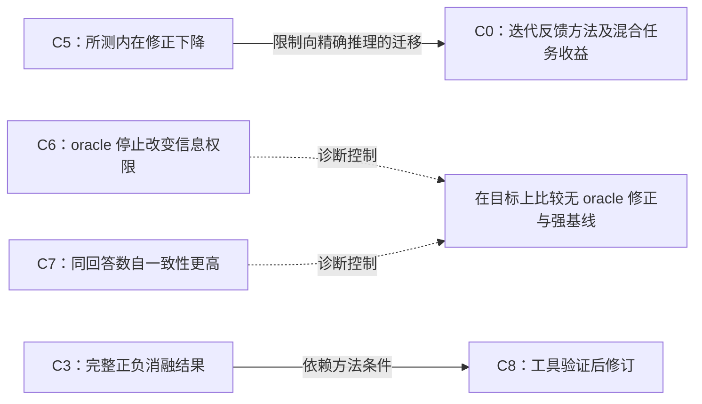

# 修正版示例：先核对主结论，再决定读什么

2026-10-31 · 固定三篇历史材料的 Map；只核对相关章节，不代表当前领域全景。

**更正说明：** 初版数字和出处正确，但只提取 Huang 等的提示混杂例子，漏掉其内在修正、oracle 停止和等回答数基线结果；CRITIC 也只展示了部分正向无工具行。这是实质性的提取偏差。原版保留在 [历史快照](../../evals/runs/example-v1/report.md)，新账本保留原有 C1–C4，补入 C0/C5–C8；旧的宽泛 Q1 退役，改用具体命题 Q2–Q5。

对“冻结模型修正是否值得替代重采样”，本包支持的行动是：**先验证无 oracle 的修正、正确答案损伤和强预算基线，暂不把修正必然有益当成立项前提。** 这些历史结果没有直接决定一个尚未指定的 2026 模型会怎样。

## 主论点与决定性证据

| 论文 | 主论点与核对位置 | 对这次决策的意义 |
|---|---|---|
| [Self-Refine](https://proceedings.neurips.cc/paper_files/paper/2023/file/91edff07232fb1b55a505a9e9f6c0ff3-Paper-Conference.pdf) | 同模型反馈与修订可改善多种任务；§2–3/Table 1。数学行只有 0、+0.2、+0.2pp | 保留方法价值，也保留任务边界，不能从偏好类收益直接推出精确推理收益 |
| [Huang 等](https://proceedings.iclr.cc/paper_files/paper/2024/file/8b4add8b0aa8749d80a34ca5d941c355-Paper-Conference.pdf) | §3/Table 3：两轮内在修正的 GSM8K 点估计下降；§3/Table 2 的 oracle 停止利用正确性标签；§4/Table 7 比较同回答数的辩论与自一致性 | 这是本问题最直接的负向依据与评价控制，应先读。§5/Table 8 的提示混杂是补充，不能替代主结果 |
| [CRITIC](https://proceedings.iclr.cc/paper_files/paper/2024/file/fef126561bbf9d4467dbb8d27334b8fe-Paper-Conference.pdf) | 工具交互验证是主要方法；§2/4.2/Table 2。无工具消融既有正行也有负行，Appendix D.6 还复用了旧比较结果 | 区分外部反馈、程序生成和纯文本推理；不将每行视为独立复制 |

Huang Table 3 的 GSM8K 变化：GPT-3.5 **75.9→74.7%**，GPT-4 **95.5→89.0%**，调用从 1 次增至 5 次。§3.1 说明前者使用完整 1,319 题，后者抽样 200 题。这是所测协议的报告结果，不是对所有模型的不可行证明。Table 7 在 6/9 个回答下，辩论为 **83.2/83.0%**，自一致性为 **85.3/88.2%**；回答数相等仍不等于总 token 相等。[主来源 §3–4](https://proceedings.iclr.cc/paper_files/paper/2024/file/8b4add8b0aa8749d80a34ca5d941c355-Paper-Conference.pdf)。

CRITIC Table 2 的无工具相对 PoT 变化在 GSM8K/SVAMP/TabMWP 上分别是：gpt-3.5-turbo **+4.5/0/+12pp**，text-davinci-003 **−1.8/−3.3/+20.3pp**。这些点估计应一起读；程序的最终执行评分也不能与修正期间是否获取执行反馈混为一谈。[主来源 §4.2](https://proceedings.iclr.cc/paper_files/paper/2024/file/fef126561bbf9d4467dbb8d27334b8fe-Paper-Conference.pdf)。

另一个待核实点是同一 CRITIC PDF 的内部报告差异：Text-Davinci-003 的 GSM8K 工具版在 Table 2 为 **72.2%**，Appendix D.6/Table 10 为 **71.2%**。本例按 Table 2 提取，保留差异，未确定其来自版本、设置或排版；这首先是来源核实问题，不据此宣布新的研究 gap。[主来源两表](https://proceedings.iclr.cc/paper_files/paper/2024/file/fef126561bbf9d4467dbb8d27334b8fe-Paper-Conference.pdf)。

## 阅读队列与有区分度的判断

1. **精读 Huang §3–4**，再读 §5：明确 oracle 权限、修正损伤与基线。它最直接改变立项假设。
2. **定点读 Self-Refine §2/Table 1/Appendix K.1**：复原方法，区分任务、指标和反馈制度。
3. **定点读 CRITIC §4.2 的完整 Table 2 与 Appendix D.6**：检查主要方法、正负消融和复用来源。

暂缓与当前精确推理决策无关的偏好及毒性细节。本轮只有一篇精读，另两篇局部阅读。

| 命题 | 账本判断 | 为什么 |
|---|---|---|
| Q2：Table 3 所列两列模型在两轮修正后点估计更高 | `refuted` | 表内两列均下降；这只驳倒这个精确的报告结果断言，不作总体显著性或全模型推论 |
| Q3：Table 7 的辩论在 6/9 个回答下高于自一致性 | `refuted` | 两个回答数下均更低；该实验不是单模型修正，也不是总 token 匹配 |
| Q4：用户尚未指定的新模型会在等总成本下获益 | `insufficient` | 历史结果是上下文与诊断依据，目标条件缺失，不能伪装成直接支持/反证 |
| Q5：CRITIC 所列两模型的工具版 GSM8K 点估计高于 PoT | `conditional` | 一项原始研究中的条件支持，不等于独立复现或无工具收益 |

## 关系网络与分歧

实线为有原文位置的关系，虚线为本示例的研究决策综合。自我修正方法、信息访问和评价控制形成相连分支，并不是“后发表的推翻先发表的”单线历史。

这里没有建立同条件、足够精确的未解冲突。不同提示、模型、程序/文本任务和停止规则使跨论文相反方向更适合标为 `scope_mismatch`。没有冲突本身也是结果。CRITIC 复用的旧比较行保持原来源家族，不增加独立确认；三篇文章的数量也不构成三个独立的等预算复制实验。

## 下一步能改变决策的观察

以下是本示例的建议，不是已执行或已核查新颖性的方法：在明确的目标模型、任务与总 token/call 预算下，比较充分初始提示后的回答、无工具修正、等成本重采样/选择；禁用 oracle 选择和停止。记录最终选定答案准确率、wrong→right、right→wrong、全成本及配对不确定性。

“内在批评有信息价值”预测其在公平预算和选择控制后仍有净优势；“额外计算或弱初始提示解释收益”预测强提示或重采样可匹配表现。若修正的救回被改错抵消，或公平基线消除了实用优势，应放弃或收窄特殊修正机制的 motivation；区间太宽则保持未定，不写成零效应。

## 覆盖与机器检查的边界

本次重查三篇的主要结论和相关结果块，没有逐页通读、审计全部原始预测、复现实验、近期搜索或完整前向引文。方法与表格分母、选择和预算限制保存在账本。检查器能检查主结论字段是否缺失，**不能知道字段里是否真的是主结论**；修正后的零错误仍不等于科学正确性证明。日志见 [search-log.md](search-log.md)。
